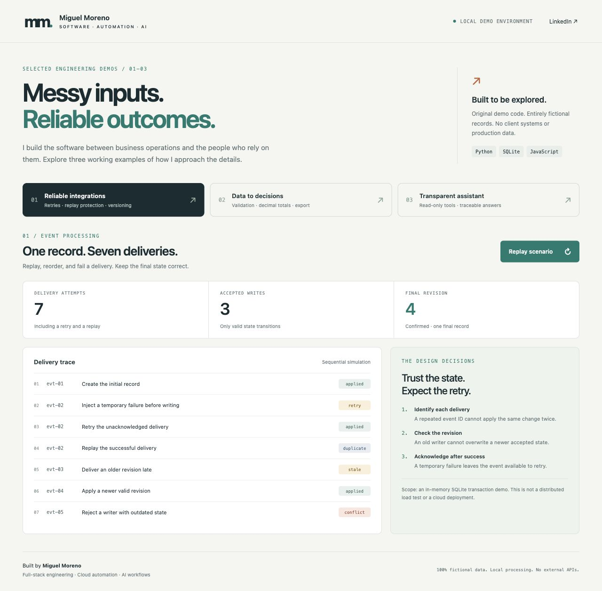
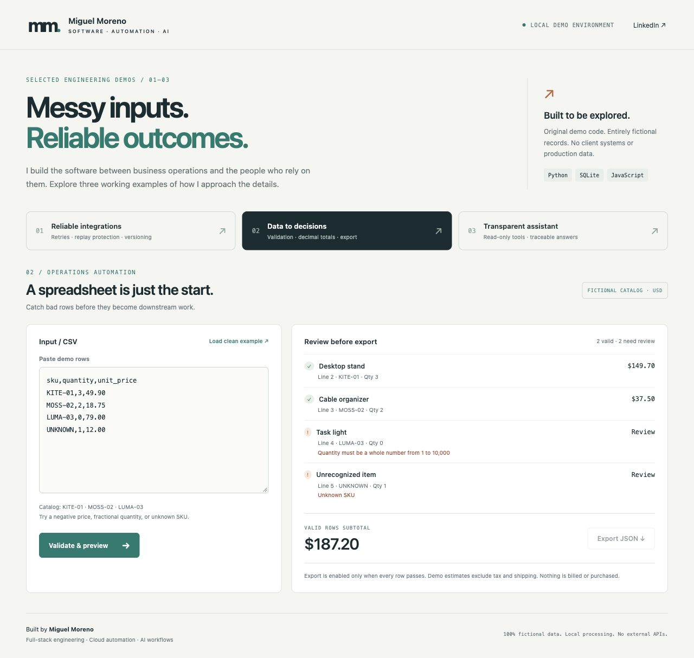
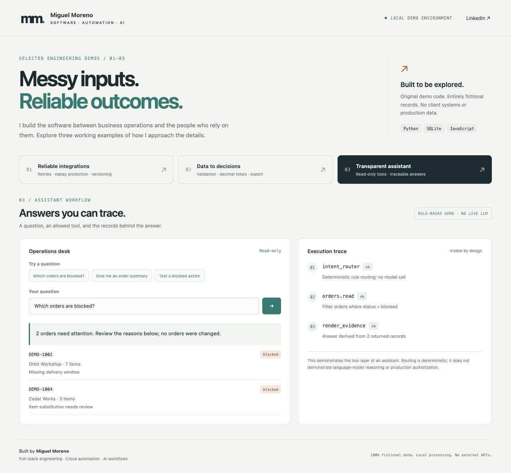

# Miguel Moreno · Engineering in practice

I build full-stack applications, cloud automations, and AI-assisted workflows that make everyday operations more reliable.

This is my public engineering portfolio: **three original, runnable demonstrations built with fictional data**. The code, interfaces, and screenshots were created specifically for this repository. They are not extracts, replicas, or anonymized exports of client systems.

[Professional profile](https://www.linkedin.com/in/miguelven/) · [Architecture & tradeoffs](docs/ARCHITECTURE.md) · [Use in applications](docs/APPLICATIONS.md)

## Start with the work

| Demonstration | What to try | What it shows |
| --- | --- | --- |
| **01 · Reliable integrations** | Run seven deliveries, including failure, retry, replay, stale data, and a conflicting writer | Transaction boundaries, idempotency, revision checks, and visible outcomes |
| **02 · Data to decisions** | Validate a deliberately flawed CSV, load the clean sample, then export | Row-level feedback, decimal arithmetic, and safe export gating |
| **03 · Transparent assistant** | Ask about blocked orders, inspect a specific order, or request a prohibited action | Read-only tools, evidence-backed answers, explicit unsupported intents |

### 01 · Reliable integrations



The temporary failure leaves no acknowledgement. A retry succeeds, its replay is ignored, an old revision cannot reverse the result, and a conflicting writer cannot overwrite newer state. Each run starts with a fresh SQLite database in memory.

### 02 · Data to decisions



Invalid quantities and unknown items are explained in place. A clean input enables a JSON download. Totals use Python's `Decimal`; invalid rows never silently contribute to the subtotal, and a changed input invalidates its previous preview.

### 03 · Transparent assistant



The answer includes the records that support it. This intentionally uses **deterministic routing, not a live LLM**. It demonstrates the tool and evidence layer without sending any data to a model provider. All implemented tools are read-only; the phrase filter is a demonstration, not a production authorization system.

## Run locally

Requires **Python 3.10+**. There are no packages to install, accounts to create, API keys, or external services.

```sh
git clone https://github.com/Migue19ve/engineering-portfolio.git
cd engineering-portfolio
python3 server.py
```

Open **http://127.0.0.1:8765**. Stop the server with Ctrl+C. To use another port: `python3 server.py --port 8766`.

The Python backend is required; opening the HTML file directly will not run the demos. This repository is not a hosted live service.

## Verify

```sh
python3 -m unittest discover -s tests -v
node --check static/app.js
node --test tests/frontend.test.cjs
python3 scripts/check_public_content.py
```

Node is only needed for the JavaScript checks and regression tests. Git is needed for the tracked-file publication check. GitHub Actions runs these checks on pushes and pull requests.

## Scope and provenance

- All company names, orders, products, amounts, identifiers, and failure scenarios are invented fixtures. No client code or data was consulted to implement these demos.
- Screenshots show this application using those fixtures. They are not production screenshots or mock images of claimed customer results.
- Requests stay on the local server. There are no runtime API integrations, analytics, external fonts, or automatic network calls beyond the local app. The LinkedIn link opens a professional profile only when clicked.
- No personal email, phone number, résumé, client names, credentials, private links, infrastructure identifiers, or internal documents are included.
- The demos illustrate engineering choices; they do not establish production scalability, distributed correctness, enterprise security, deployed AI, or measured business results.
- Development was AI-assisted, including implementation and tests. The repository is a demonstration artifact, not a claim that every line was written without assistance.

## Technical walkthrough

The backend uses Python's standard library, SQLite transactions, CSV parsing, and decimal arithmetic. The frontend is accessible HTML, responsive CSS, and browser JavaScript. See [the architecture notes](docs/ARCHITECTURE.md) for decisions, limitations, and next steps for a real deployment.

**Copyright © 2026 Miguel Moreno. All rights reserved.** Shared for portfolio evaluation; no open-source reuse license is granted. See [LICENSE](LICENSE).
